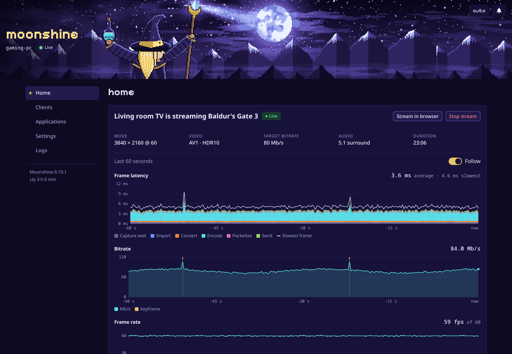
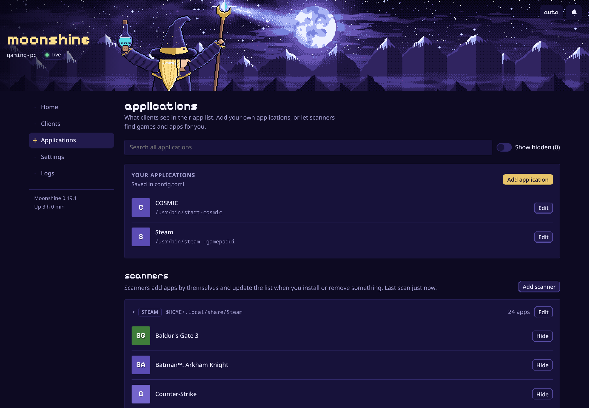
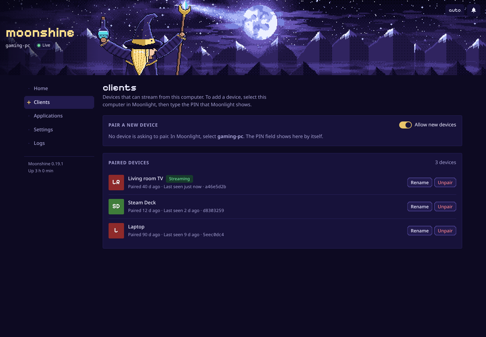
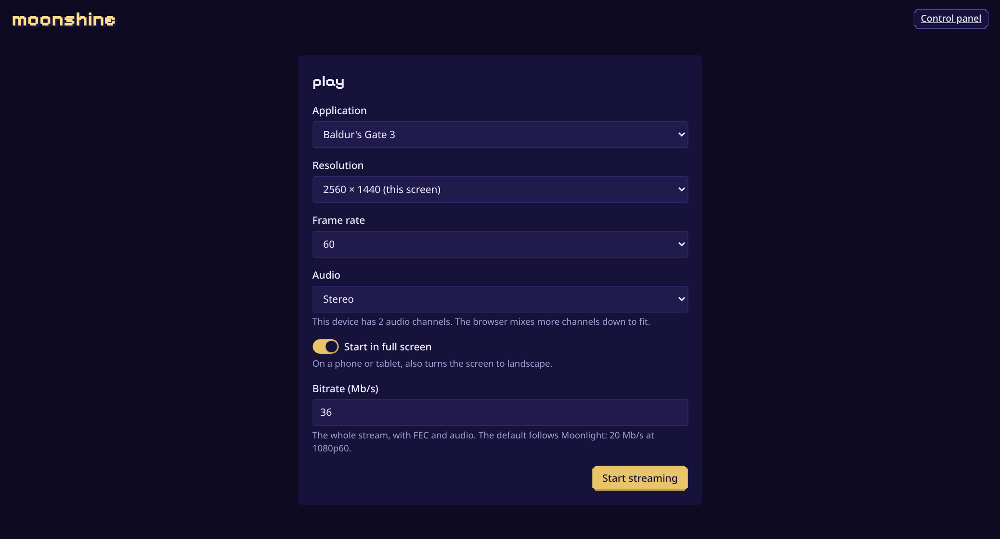

[](https://github.com/hgaiser/moonshine/actions)

# Moonshine 🌙

Moonshine lets you stream games from your PC to any device running [Moonlight](https://moonlight-stream.org/).
Your keyboard, mouse, and controller inputs are sent back to the host so you can play games remotely as if you were sitting in front of it.

## Features

- **Isolated streaming sessions**: Each stream runs in its own compositor, completely separate from your desktop environment. Your host PC can still be used for other things while you stream.
- **No monitor required**: Works on headless servers — no HDMI dummy plug needed.
- **Hardware video encoding**: H.264, H.265, and AV1 encoding using the GPU.
- **HDR support**: True 10-bit HDR streaming for supported games.
- **Full input support**: Mouse, keyboard, touchscreen, pen/stylus, and gamepad (including motion, touchpad, and haptics).
- **Audio streaming**: Stereo and surround sound (5.1/7.1) with low-latency Opus encoding.
- **Web control panel**: Pair devices, manage applications, change settings and watch live stream statistics.
- **Stream in the browser**: Play from the control panel in Chrome, Edge or Firefox, with nothing to install.



<details>
<summary><b>More screenshots</b></summary>





</details>

## Quick start

1. Install Moonshine with the [install script](#installation).
2. Open the control panel at http://localhost:47990 .
3. In Moonlight, select the host (or add it by its IP address). Moonlight shows a PIN.
4. Type the PIN on the Clients page of the control panel.
5. Select Steam (or a game) in Moonlight to start streaming.

## Requirements

1. **Linux only**, x86_64, with glibc 2.39 or newer (for example Ubuntu 24.04+, Debian 13+, Fedora 40+).
1. **systemd**. Required for launching and managing application processes. Almost all modern Linux distributions include it by default.
1. **A GPU with Vulkan video encoding**. NVIDIA RTX, AMD RDNA2+, or Intel Arc.
1. **Moonlight v6.0.0 or higher**. Compatibility with older versions or unofficial ports is not guaranteed.

## Installation

Run the install script as your normal user (not with `sudo`). It asks for `sudo` when it needs it:

```sh
curl -fsSL https://github.com/hgaiser/moonshine/releases/latest/download/moonshine-install.sh | bash
```

The script picks the installation method for your system:

| System | Method |
|---|---|
| Arch, CachyOS, EndeavourOS, Manjaro, ... | The `moonshine-bin` AUR package, with `paru`, `yay` or `makepkg` |
| Debian, Ubuntu, Linux Mint, Pop!_OS, ... | The release `.deb`, with `apt` |
| Fedora, Nobara, ... | The release `.rpm`, with `dnf` |
| Bazzite, Silverblue, Kinoite and other Fedora Atomic distros | The release `.rpm`, layered with `rpm-ostree` (reboot after install) |
| SteamOS, and every other distro | The release tarball, unpacked into `/opt/moonshine` |
| NixOS | Nothing: use the [NixOS module](#nixos) |

It checks each download against the release's `SHA256SUMS`. It then offers to do the steps in [Enable the service](#enable-the-service) for you.

- **Upgrade**: run the script again. It keeps the method of the current installation.
- **Uninstall**: `curl -fsSL https://github.com/hgaiser/moonshine/releases/latest/download/moonshine-install.sh | bash -s -- --uninstall`
- **Preview**: add `--dry-run` to see the method and the commands, without changes.
- **Choose the method**: add `--method aur|deb|rpm|ostree|opt`.

Run the script with `--help` for all options.

### Manual installation

Download the package from the [releases page](https://github.com/hgaiser/moonshine/releases), install it, then do the steps in [Enable the service](#enable-the-service).

| System | Command |
|---|---|
| Arch | `yay -S moonshine-bin` |
| Debian / Ubuntu | `sudo apt install ./moonshine_*.deb` |
| Fedora / RHEL | `sudo dnf install ./moonshine-*.rpm` |
| Fedora Atomic (Bazzite, Silverblue, ...) | `sudo rpm-ostree install ./moonshine-*.rpm`, then reboot |

To build from source, see [Building from source](#building-from-source).

### NixOS

Moonshine and its `services.moonshine` module are in nixpkgs. The module does all the steps in [Enable the service](#enable-the-service), so skip them.

```nix
services.moonshine = {
  enable = true;
  user = "alice"; # must be declared in users.users
  # Required: the default application points at /usr/bin/steam, which doesn't exist on NixOS.
  settings.application = [
    {
      title = "Steam";
      command = [ "/run/current-system/sw/bin/steam" "steam://open/bigpicture" ];
      steam_integration = true;
    }
  ];
  # Opens the ports on these interfaces only; see Security below.
  # firewallInterfaces = [ "tailscale0" ];
};
```

See all options at [search.nixos.org](https://search.nixos.org/options?channel=unstable&query=services.moonshine).
This repository is also a flake that builds the latest commit. See [nix/README.md](nix/README.md).

### Enable the service

The install script and the NixOS module do these steps for you. Do them yourself after a manual installation.

1. **Enable user lingering**, so Moonshine can run applications when you are not logged in:
   ```sh
   sudo loginctl enable-linger $USER
   ```
   If you are always logged in when you stream, you can skip this step.

2. **Start the service now and on boot**:
   ```sh
   sudo systemctl enable --now moonshine@$USER
   ```

3. **Gamepad support when streaming headless** (no active desktop session): add your user to the `input` group, then log out and back in:
   ```sh
   sudo usermod -aG input $USER
   ```
   The streamed game must be able to read the virtual gamepads that Moonshine creates. With an active desktop session, your user already has this access, so you can skip this step.

## Configuration

The service reads `~/.config/moonshine/config.toml`. Moonshine creates this file on the first start.
The default configuration streams Steam Big Picture and finds your installed Steam games, so most users do not have to change anything.

### Control panel

Moonshine has a web control panel at http://localhost:47990 . With it you can:

- See the stream that runs now, with live graphs of latency, bitrate and frame rate, and stop it.
- See the health checks, and run them again.
- Pair new devices with their PIN, and rename or unpair paired devices.
- Add and edit applications and scanners, and hide scanned applications from clients.
- Change settings. Each setting shows if it applies now, at the next stream, or after a restart.
- Read the logs, and download a report for bug reports.
- Stream an application in this browser (see [Streaming in the browser](#streaming-in-the-browser)).

The control panel writes its changes to `config.toml` and keeps your comments in place.
By default, only this computer can open it. To open it from other devices, add their address range:

```toml
[ui]
allowed_networks = ["127.0.0.1/32", "::1/128", "192.168.1.0/24"]
```

> [!WARNING]
> Anyone who can open the control panel can add applications, which run commands as your user. Only add address ranges that you trust. The control panel has no password.

Set `enabled = false` in the `[ui]` table to turn the control panel off.
To open it through a reverse proxy, see [TIPS.md](TIPS.md#open-the-control-panel-through-a-reverse-proxy).

### Streaming in the browser

Select **Stream in browser** in the control panel, or open http://localhost:47990/play .
It works in Chrome, Edge and Firefox.

- The stream uses UDP port 47990: open it in the firewall.
- From other devices, the page uses HTTPS with a self-signed certificate, so the browser warns the first time. To use your own, set `certificate` and `private_key` in `[ui]`.
- To turn it off, set `streaming = false` in `[ui]`.

### Pairing with a client

When you connect with Moonlight for the first time, it shows a PIN.
Type it on the Clients page of the [control panel](#control-panel).
You can also click the notification on the host, or open http://localhost:47989/pin .
To pair without a browser, see [TIPS.md](TIPS.md#pair-a-client-from-the-command-line).

### Adding applications

Each application runs in its own isolated streaming session. Add them in the control panel, or in `config.toml`:

```toml
[[application]]
title = "Steam"
command = ["/usr/bin/steam", "steam://open/bigpicture"]
boxart = "/path/to/steam.png"
steam_integration = true
pre_command = [
    ["/usr/bin/systemctl", "stop", "conflicting.service"],
]
post_command = [
    ["/usr/bin/systemctl", "start", "conflicting.service"],
]
```

- `title`: The name shown in Moonlight.
- `command`: The command to run. The first entry is the executable, the rest are arguments.
- `boxart` (optional): Path to a cover image.
- `working_directory` (optional): The directory to start the application (and its `pre_command` and `post_command`) in. `~` and environment variables are expanded. The directory must exist. Defaults to your home directory.
- `steam_integration` (optional): Turn it on for Steam Big Picture, so its overlay and focus work. Leave it off for everything else. Off by default.
- `pre_command` (optional): Commands to run before the application starts. They run in order, and the session waits until they finish.
- `post_command` (optional): Commands to run after the session ends. They run in order, and the session waits until they finish.

See [TIPS.md](TIPS.md) for practical recipes with these fields.

### Application scanners

Scanners find installed applications, so you don't have to add them one by one:

- **Steam**: installed Steam games (on by default).
- **Desktop**: applications from `.desktop` files.
- **Lutris**, **Heroic**, **Bottles** and **Faugus**: games from these launchers.

```toml
[[application_scanner]]
type = "steam"
library = "$HOME/.local/share/Steam"
command = ["/usr/bin/steam", "-bigpicture", "steam://rungameid/{game_id}"]
```

See [SCANNERS.md](SCANNERS.md) for the options of each scanner.

## Troubleshooting

- Run `moonshine healthcheck` to check the GPU, codec support and ports. Add `--config ~/.config/moonshine/config.toml` to also check your configured ports and GPU.
- Read the logs with `journalctl -u moonshine@$USER`, or on the Logs page of the control panel.
- If an application does not start, see [Debug a failing application](TIPS.md#debug-a-failing-application).
- When you report a bug, attach the report from the Logs page of the control panel.

## FAQ

1. **How does this compare to [Sunshine](https://github.com/LizardByte/Sunshine)?**

   Sunshine supports more platforms and has more features. Moonshine is Linux-only, and runs each stream in its own compositor instead of capturing your desktop.

2. **Can I use Moonshine to stream to two clients simultaneously?**

   This is currently not a supported feature and not a focus of Moonshine. If you are interested in adding support for this, feel free to open an issue or discuss on [Discord](https://discord.com/invite/moonlight-stream-352065098472488960).

## Security

Moonshine is **not designed for use on public networks**. **Do not expose Moonshine ports directly to the internet.**
The underlying GameStream protocol has limitations that mean traffic is not fully encrypted at the application level.

If you need to stream over the internet, use a VPN such as [Tailscale](https://tailscale.com/), [WireGuard](https://www.wireguard.com/), or [ZeroTier](https://www.zerotier.com/).

## Building from source

These commands are for Arch Linux. Other distributions have the same packages under similar names.

```sh
# Build dependencies
sudo pacman -S clang cmake jq libc++ rust

# Runtime dependencies
sudo pacman -S gcc-libs glibc libevdev libxkbcommon mesa opus wayland xorg-xwayland
```

Build:

```sh
cargo build --release --workspace
```

Set up the environment:

```sh
# Install uinput/uhid kernel modules
sudo install -Dm644 dist/moonshine-modules.conf /usr/lib/modules-load.d/moonshine.conf
sudo modprobe uinput uhid

# Install udev rules for input device access
sudo install -Dm644 dist/60-moonshine.rules /usr/lib/udev/rules.d/60-moonshine.rules
sudo udevadm control --reload-rules

# Allow the moonshine group to keep the computer awake while streaming
# (run Moonshine with this group, or add your user to it)
sudo groupadd --system moonshine
sudo install -Dm644 dist/50-moonshine-inhibit-sleep.rules /etc/polkit-1/rules.d/50-moonshine-inhibit-sleep.rules

# Install ferriscope's Vulkan WSI layer for game rendering
dist/install-wsi.sh   # builds as you, asks for sudo only to install
```

Run:

```sh
cargo run --release -- /path/to/config.toml
```

## Contributing

Bug reports and pull requests are welcome on [GitHub](https://github.com/hgaiser/moonshine/issues).
See [CHANGELOG.md](CHANGELOG.md) for the changes in each release.

## Acknowledgement

This wouldn't have been possible without the incredible work by the people behind the following projects:

1. [Moonlight](https://moonlight-stream.org/), without it there would be no client for Moonshine.
2. [Sunshine](https://github.com/LizardByte/Sunshine), which laid a lot of the groundwork for the host part of the API.
3. [Inputtino](https://github.com/games-on-whales/inputtino), for a thorough implementation of input devices.
4. [magic-mirror](https://github.com/colinmarc/magic-mirror), for inspiration of using Vulkan and a Wayland compositor for headless streaming.

## License

Moonshine is licensed under the [BSD 2-Clause License](LICENSE).
